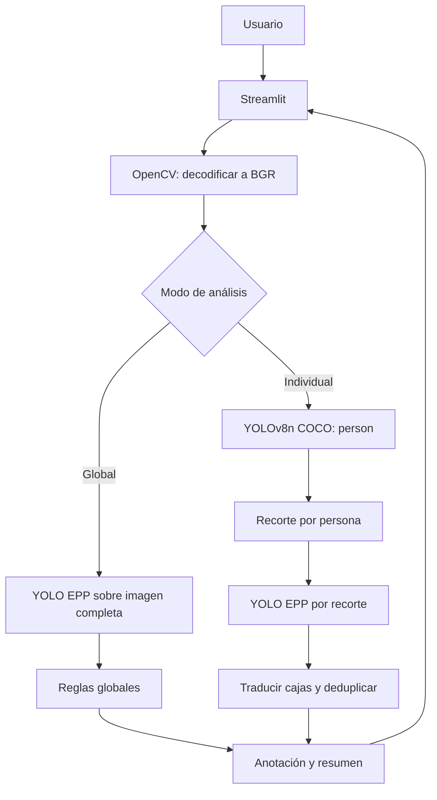

# Arquitectura de LabGuard AI

Este documento describe únicamente la arquitectura implementada en el commit `1929ba4`.

## Vista general

LabGuard AI separa dominio, detección, procesamiento y presentación. Los modelos se cargan de forma diferida cuando llega una imagen; no se descargan automáticamente.

## Capas y módulos

| Ruta | Responsabilidad implementada |
|---|---|
| `app.py` | Agrega `src/` al path y llama a la interfaz Streamlit. |
| `src/labguard_ai/core/` | Enumera EPP y define dataclasses inmutables para detecciones y resultados. |
| `src/labguard_ai/config.py` | Lee `configs/model.yaml`, resuelve rutas y valida parámetros de CPU. |
| `src/labguard_ai/detection/utils.py` | Normaliza matrices NumPy a imágenes BGR contiguas. |
| `src/labguard_ai/detection/yolo.py` | Adapta un checkpoint YOLO local a detecciones EPP internas. |
| `src/labguard_ai/detection/person.py` | Ejecuta la clase COCO `person` y asigna IDs temporales. |
| `src/labguard_ai/compliance/rules.py` | Compara categorías visibles con las cinco categorías internas. |
| `src/labguard_ai/processing/image.py` | Conecta detector EPP y evaluación global. |
| `src/labguard_ai/processing/person.py` | Recorta personas, traduce detecciones y resuelve duplicados. |
| `src/labguard_ai/ui/images.py` | Decodifica, dibuja y resume resultados con OpenCV. |
| `src/labguard_ai/ui/app.py` | Define controles, caché de sesión, flujo y presentación Streamlit. |
| `training/` | Valida datasets, ejecuta fine-tuning confirmado y evalúa checkpoints. |

`src/labguard_ai/processing/video.py` contiene una interfaz futura que lanza `NotImplementedError`. `src/labguard_ai/reporting/generator.py` contiene solo un protocolo; no existe un generador concreto.

## Tipos de dominio

`PpeType` define cinco categorías internas:

- `lab_coat`
- `protective_gloves`
- `safety_goggles`
- `lab_cap`
- `face_mask`

El checkpoint EPP actual utiliza otros nombres. `configs/model.yaml` traduce `Gloves`, `goggles` y `mask` a las categorías internas. Las clases no mapeadas se descartan.

`EvaluationStatus` evita convertir una ausencia de detección en una afirmación definitiva:

| Estado | Significado |
|---|---|
| `detected` | El modelo devolvió una detección mapeada. |
| `undetermined` | La clase es evaluable, pero no se confirmó en ese recorte. |
| `not_evaluable` | El modelo actual no representa esa clase en la aplicación. |

## Configuración

La aplicación carga únicamente `configs/model.yaml`.

Parámetros activos:

- Ruta del modelo EPP: `models/best.pt`.
- Mapeo de clases EPP.
- Dispositivo: solo `cpu`.
- Confianza, IoU y tamaño de inferencia.
- Ruta y parámetros del detector de personas.

Los campos `architecture`, `source`, `filename`, `sha256` y `hardware` son metadatos, pero el cargador actual no los valida. `repository` y `revision` se conservan en la configuración, pero no activan descargas.

`configs/app.yaml` y `configs/compliance.yaml` no son leídos por el código actual. Por ello, `allow_camera: true` no habilita cámara y `required_ppe` no modifica las reglas en ejecución.

## Flujo de análisis global

1. Streamlit acepta un único JPG, JPEG o PNG.
2. `decode_uploaded_image` usa `cv2.imdecode` y produce una matriz BGR `uint8`.
3. `YoloPpeDetector` carga `models/best.pt` la primera vez que se utiliza.
4. `YOLO.predict` recibe imagen, CPU, confianza, IoU y tamaño seleccionados.
5. Solo las clases incluidas en `class_mapping` se convierten a `Detection`.
6. `ImageAnalyzer` entrega las detecciones al evaluador global.
7. OpenCV dibuja cajas y etiquetas en una copia de la imagen.
8. Streamlit muestra conteos, confianza y un resumen limitado a las clases soportadas.

El evaluador interno considera las cinco categorías de `PpeType`, pero la interfaz vuelve a resumir el resultado usando solo las categorías mapeadas. Así, bata y gorro aparecen como no evaluables en vez de incumplimientos.

### Semántica global

Las detecciones se agrupan por categoría para toda la fotografía. Si aparece un guante, la categoría guantes se considera visible globalmente. Este modo no conoce cuántas personas deberían usarlo ni a quién pertenece.

## Flujo de análisis por persona

1. `YoloPersonDetector` carga `yolov8n.pt` y llama a YOLO con `classes=[0]`.
2. Las personas se ordenan por coordenada izquierda, luego superior y confianza.
3. Se asignan IDs temporales `Persona 1`, `Persona 2`, etc.
4. Cada caja se recorta al límite de la imagen.
5. El modelo EPP se ejecuta por separado en cada recorte.
6. Las cajas locales se traducen a coordenadas de la fotografía completa.
7. Los candidatos del mismo EPP se consideran duplicados si superan IoU `0.50` o si la intersección cubre al menos 80 % de la caja menor.
8. Se conserva el candidato de mayor confianza.
9. Cada persona recibe estados para los cinco tipos de EPP.

Esta asociación depende del contenido del recorte. Si dos cajas de persona se superponen, un EPP puede aparecer en ambas; la deduplicación conserva una detección, pero no garantiza que quede asignada a la persona correcta. No hay pose, landmarks, tracking ni identidad persistente.

## OpenCV

OpenCV se utiliza para:

- Decodificar bytes JPG o PNG.
- Convertir escala de grises, un canal o BGRA a BGR.
- Asegurar memoria contigua antes de YOLO.
- Dibujar cajas, fondos de etiquetas, texto y primitivas de advertencia.
- Evitar, cuando existe espacio, superposición entre etiquetas y regiones protegidas.

La imagen original no se modifica durante la anotación. Streamlit recibe las matrices con `channels="BGR"`.

No existe captura con `cv2.VideoCapture` ni procesamiento de video.

## YOLOv8 y PyTorch

Se usan dos instancias independientes:

| Modelo | Ejecución | Propósito |
|---|---|---|
| `yolov8n.pt` | Una vez por imagen en modo individual | Detectar personas COCO. |
| `models/best.pt` | Una vez globalmente o una vez por recorte | Detectar EPP mapeado. |

Los adaptadores importan Ultralytics solo cuando necesitan cargar el modelo. Exigen un archivo `.pt` local y evitan una descarga implícita. La aplicación usa CPU; el entrenamiento tiene su propio parámetro de dispositivo.

Consulta [Modelos](MODELOS.md) para clases, versiones y SHA-256.

## Streamlit

La interfaz implementa:

- Slider de confianza EPP entre `0.10` y `0.60`.
- Slider de tamaño entre `512` y `640`.
- Toggle de análisis individual.
- Toggle de advertencias visuales.
- Carga de una imagen.
- Comparación original/anotada.
- Métricas globales o tarjetas por persona.

Los analizadores se guardan en `st.session_state` y se reconstruyen cuando cambia una clave relevante. El toggle de advertencias no produce iconos actualmente: las primitivas existen, pero no hay detector facial ni evidencia de ausencia conectada.

## Entrenamiento y evaluación

`training/validate_dataset.py` verifica estructura YOLO, imágenes, etiquetas, clases y cajas. `training/train.py` no entrena sin `--execute`. `training/evaluate.py` exige exactamente las seis clases del contrato LabGuard y exporta métricas JSON.

El dataset no forma parte del repositorio. El checkpoint de entrenamiento usa nombres distintos al modelo actual y requiere cambiar `configs/model.yaml` antes de integrarlo. Consulta `training/README.md`.

## Límites de confianza

- La aplicación no valida el SHA-256 al arrancar.
- No valida que el checkpoint EPP cargado conserve las clases esperadas.
- Un `.pt` no confiable puede ser peligroso al deserializarse.
- No hay autenticación, persistencia ni auditoría de quién procesa una fotografía.
- Los resultados viven en la sesión de Streamlit y no se exportan.
